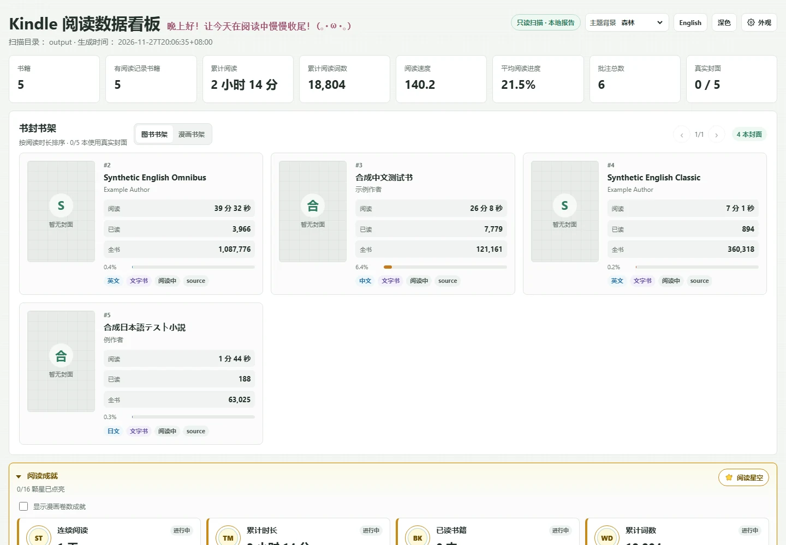
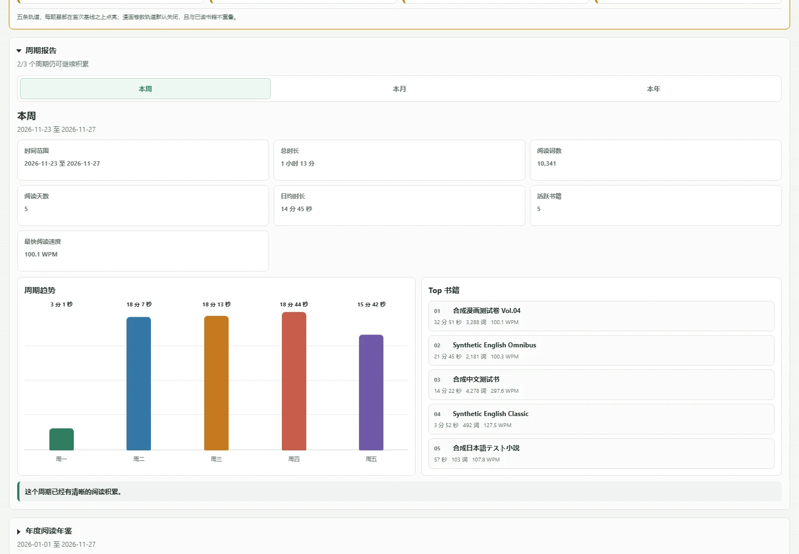
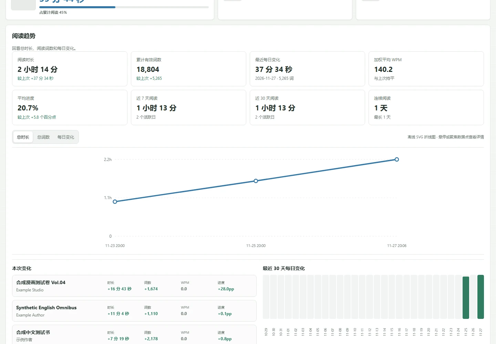
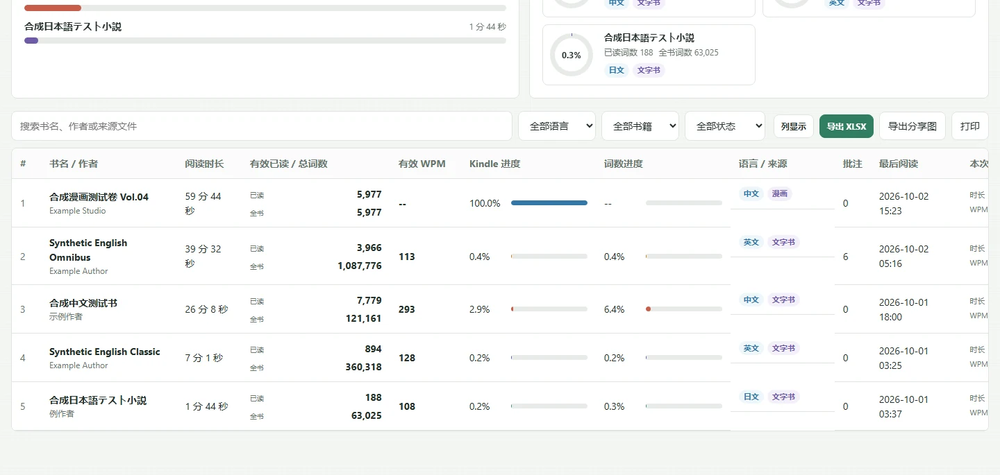
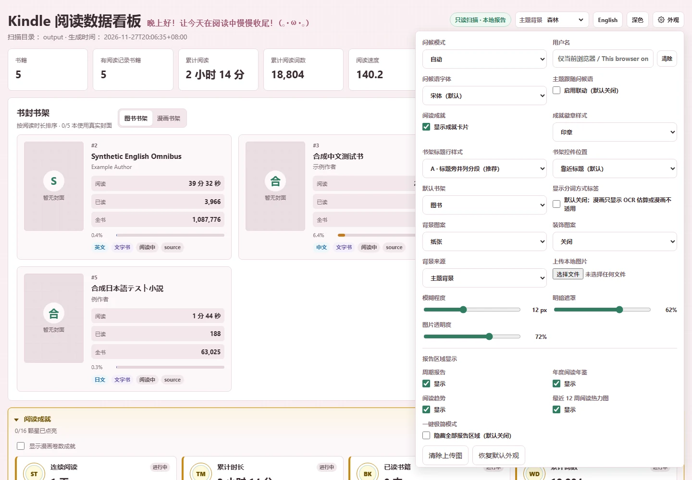
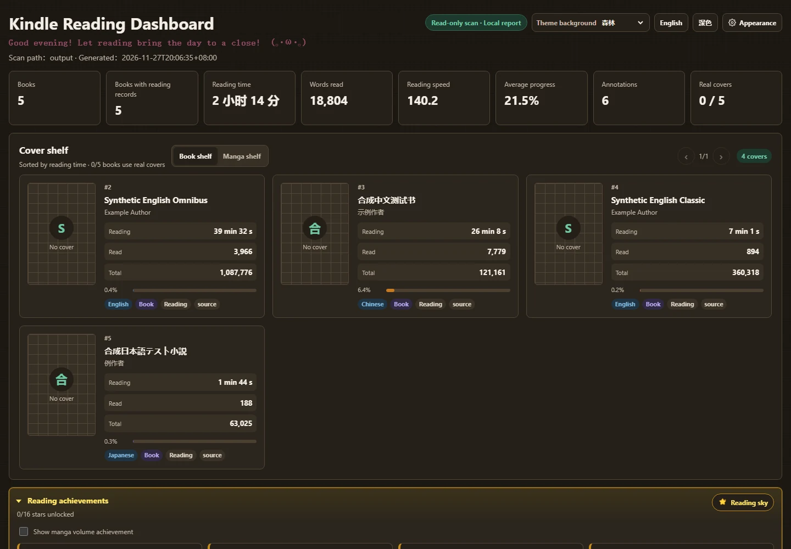

# Kindle Reading Dashboard v1.13.0 | Text + Manga

Released 2026-11-27 for Windows 10 / 11 x64.

## Downloads

| Edition | File | Scope |
| --- | --- | --- |
| Text-only | `KindleReader-Text-v1.13.0.exe` | Text books, dashboard, history and achievements; no manga or OCR module |
| Text + Manga | `KindleReader-OCR-v1.13.0.exe` | Adds manga classification, page/progress reporting, KFX position mapping and optional OCR |

Also attached: `SHA256SUMS.txt`, `settings.example.json` and
`book_modes.example.json`.

## Highlights / 功能亮点

- Read-only local scan of KRDS sidecars, covers, ebook metadata and
  `fmcache.db`; no Amazon login or cloud statistics.
- Offline HTML dashboard with search, sorting, column controls, print, XLSX
  export and in-browser share-image export.
- Period reports, annual report, 12-week heatmap, history snapshots, streaks
  and four-star achievement tracks.
- Shelf views for books and manga, configurable themes, cover backgrounds,
  shelf styles and visible report sections.
- Text + Manga edition adds source-file page counts, pages read, progress and
  KFX position mapping.
- Optional OCR remains explicitly labelled as an estimate and never replaces
  Kindle values or exact text-derived word counts.

中文摘要：本版本支持 Kindle 只读扫描、本地 HTML 看板、CSV/XLSX、搜索筛选、
分页书架、外观设置、周期/年度报告、趋势热力图、历史快照、连续阅读和成就系统。
漫画版额外提供源文件页数、已读页数、进度与 KFX 位置映射；OCR 始终作为可选估算值。

## Screenshots / 效果展示

The screenshots below are rebuilt from the repository's five-book synthetic
fixture. The originals of personal dashboards are not published.
以下截图均由仓库中的五册合成夹具重新生成，不会公开真实书名、用户名或阅读记录。

| Overview / 总览 | Period report / 周期报告 |
| --- | --- |
|  |  |
| **Trends / 趋势** | **Table and export / 表格与导出** |
|  |  |
| **Appearance / 外观** | **English dark mode / 英文深色模式** |
|  |  |

## 中文说明

本版本提供两个 Windows 单文件程序：

- **纯文字版**：只处理文字书统计，不加载 OCR 模块，也不提供漫画分类界面。
- **文字 + 漫画版**：在文字书功能之外，支持漫画分类、源文件页数、已读页数、
  进度、阅读时长和 KFX 位置映射。OCR 默认关闭，只有显式启用时才作为估算值运行。

漫画 OCR 不包含在 exe 中。需要时请自行准备 Calibre、Poppler、PaddleOCR、
PaddlePaddle 或 manga-ocr，以及对应的离线模型。程序不会自动下载依赖或模型。

阅读时长缺失时保持“无时长数据”，不会伪造 0 或写入估算时长。OCR 词数不会冒充
Kindle 原始值或正文精确值。

下载后请使用 `SHA256SUMS.txt` 核对文件。exe 未做商业代码签名，SmartScreen 可能
显示未知发布者提示。

## English notes

This release provides two Windows single-file executables:

- **Text-only** processes text books and does not load the OCR module or expose
  manga classification UI.
- **Text + Manga** adds manga classification, source-file page count, pages read,
  progress, duration and KFX position mapping. OCR is off by default and runs
  only when explicitly enabled as an estimate.

Manga OCR is not embedded in the executable. When needed, install Calibre,
Poppler, PaddleOCR, PaddlePaddle or manga-ocr and prepare offline model files
separately. The application does not download dependencies or models.

Missing reading duration remains unavailable; the app does not fabricate zero or
estimated duration. OCR word counts are never presented as Kindle values or exact
text-derived counts.

Verify every download against `SHA256SUMS.txt`. The executables are not
commercially code-signed, so Windows SmartScreen may show an unknown publisher
warning.

## Optional OCR dependencies / 可选 OCR 依赖

These components are not bundled with either executable. Install them from the
upstream or documented Windows distribution pages below.

| Component | Purpose | Download / documentation |
| --- | --- | --- |
| Calibre | KFX conversion, metadata and KFX position support | [Official Windows download](https://calibre-ebook.com/download_windows64) |
| Poppler | `pdfinfo` page counts and `pdftoppm` rendering | [Windows builds](https://github.com/oschwartz10612/poppler-windows/releases) |
| PaddleOCR | Chinese, English and Japanese OCR | [PaddleOCR releases](https://github.com/PaddlePaddle/PaddleOCR/releases) |
| PaddlePaddle | PaddleOCR runtime | [PaddlePaddle installation](https://www.paddlepaddle.org.cn/install/quick) |
| manga-ocr | Preferred Japanese manga OCR | [Source](https://github.com/kha-white/manga-ocr) · [Offline model](https://huggingface.co/kha-white/manga-ocr-base) |
| Tesseract | Optional English OCR backend | [Windows builds](https://github.com/UB-Mannheim/tesseract/wiki) · [Language data](https://github.com/tesseract-ocr/tessdata) |

PaddleOCR requires separate detection, classification and recognition model
files. The exact environment variables and model-directory guidance are in the
[Chinese README](https://github.com/josefawilson76-design/kindle-reading-stats/blob/main/README.md#漫画版依赖)
and [English README](https://github.com/josefawilson76-design/kindle-reading-stats/blob/main/README.en.md#requirements).

PaddleOCR 需要另外准备检测、分类和识别模型文件。具体环境变量和模型目录说明见
[中文 README](https://github.com/josefawilson76-design/kindle-reading-stats/blob/main/README.md#漫画版依赖)
和 [English README](https://github.com/josefawilson76-design/kindle-reading-stats/blob/main/README.en.md#requirements)。

## Checksums

See `SHA256SUMS.txt` in this Release.

## Privacy

No Amazon login, cloud account, token or cookie is required. The Kindle remains
read-only. Reports and caches are written only to the selected local directory.
The public repository and test fixtures use synthetic data.
